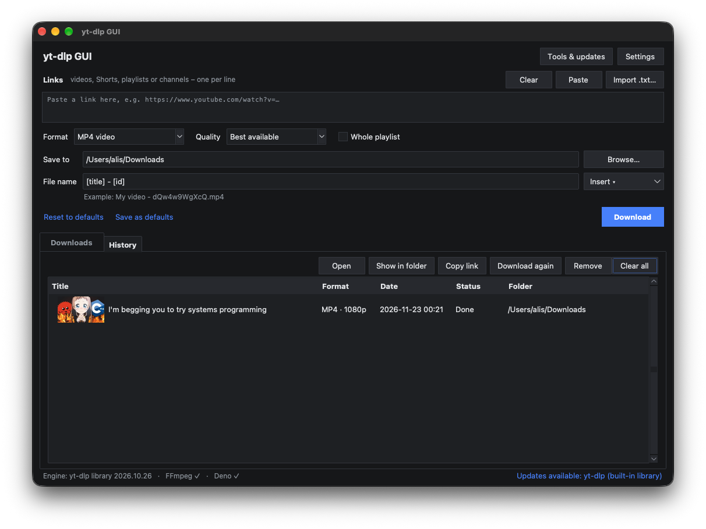

# yt-dlp GUI

A small, cross-platform desktop app for downloading videos, Shorts, playlists and whole
channels with [yt-dlp](https://github.com/yt-dlp/yt-dlp). Runs on Windows 10/11, macOS and Linux.

# Feature List 
- Paste one or more links, or import a `.txt` file of links
- Pick the format (MP4, MKV, WebM, MP3, etc), quality (4K, 72p, etc),
  folder and file name pattern for each download, with defaults you choose in Settings
- Video and audio are merged into the chosen container at the chosen quality, with the
  video's own thumbnail, metadata and chapters embedded
- Progress tracking for the current file and the whole job with time estimates
- Download history you can clear, edit, or switch off
- Light and dark themes
- Tools and updates window: one click to install or update yt-dlp, FFmpeg and Deno
- Multiple ways to run yt-dlp: via the command line tool or via the python library
- No account, login or token needed with OPTIONAL support for browser cookies in the settings menu